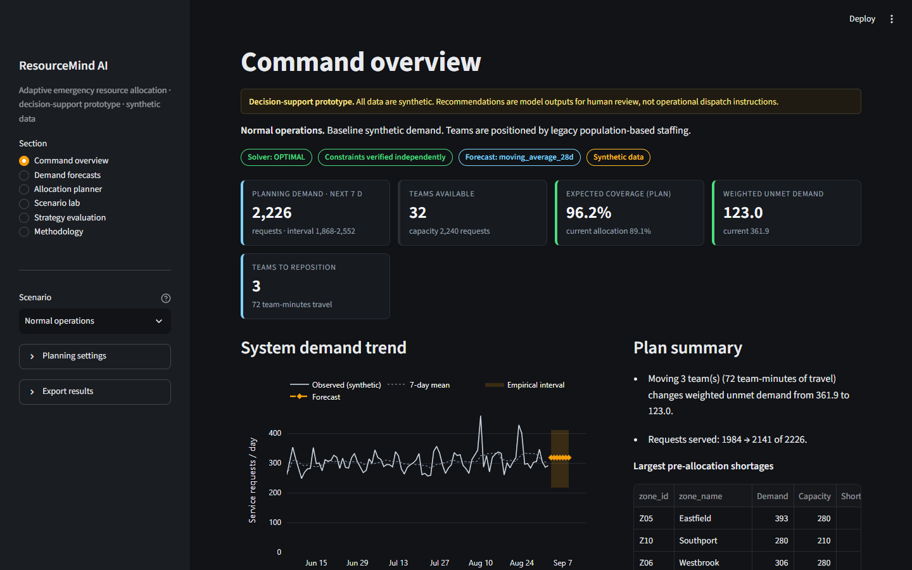
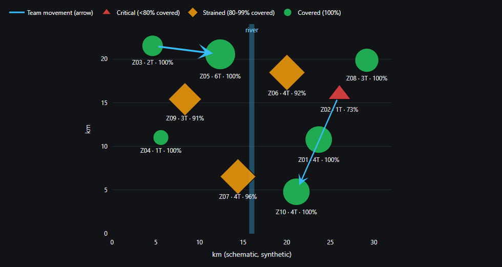
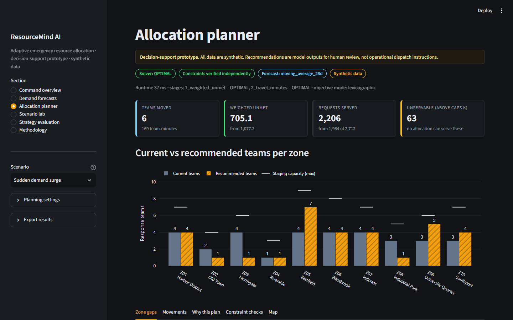
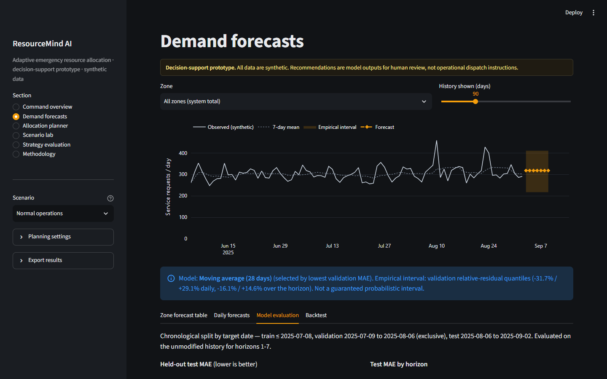
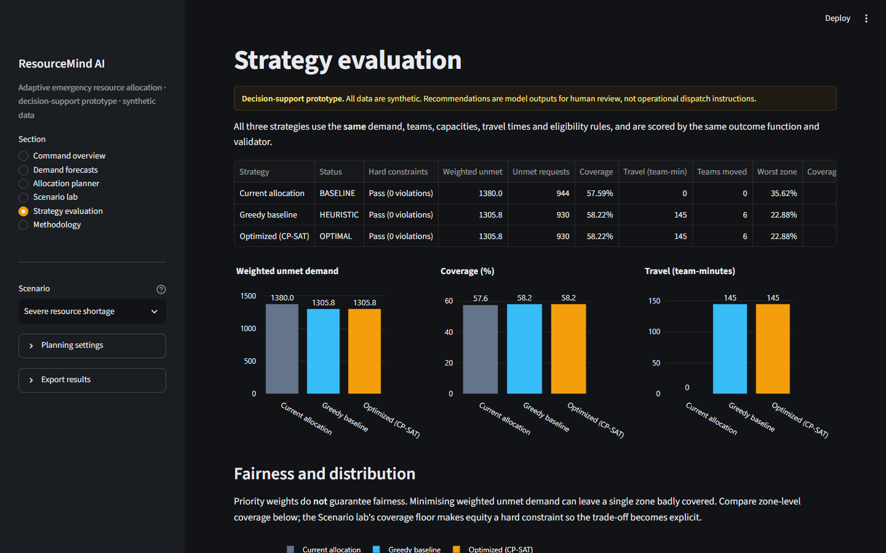

# ResourceMind AI

[](https://github.com/iwan-adler/resourcemind-ai/actions/workflows/tests.yml)

**Adaptive emergency resource allocation under changing demand: a decision-support prototype.**



ResourceMind AI forecasts near-term emergency service demand by zone, finds where team capacity falls short,
and recommends where to reposition response teams. The recommendation comes from a constrained optimization
model (Google OR-Tools CP-SAT) that is checked by an independent validator and compared against baseline
strategies. A Streamlit dashboard lets you explore scenarios, trade-offs and sensitivity.

> **All data are synthetic.** This is a prototype for learning and demonstration. It is not a validated
> operational dispatch system, and its outputs are not emergency instructions.

## Problem

Emergency services have limited teams. Demand shifts across zones and over time, so a static allocation
leaves some zones under-served while others have spare capacity. The tool:

1. forecasts demand per zone for the next 1–7 days;
2. computes shortages and surpluses (gap analysis);
3. finds a minimum-unmet-demand allocation under hard constraints;
4. explains the plan, its binding constraints and trade-offs;
5. simulates scenarios (surge, shortage, travel disruption, custom what-ifs);
6. compares it against the current allocation and a greedy heuristic;
7. evaluates forecast accuracy, coverage, efficiency, robustness, fairness and runtime.

## Features

| Area | What is implemented |
|---|---|
| Data | Deterministic synthetic generator (10 zones × 240 days, 3 demand categories, weekly/annual seasonality, spikes, city-wide events), schema validation |
| Forecasting | Seasonal naive, seasonal average, 28-day moving average and a gradient-boosting model; chronological train/validation/test; MAE/RMSE/WAPE; empirical intervals with measured coverage |
| Allocation | CP-SAT integer model with conservation, staging capacity, service caps, travel limits, blocked routes, inaccessible zones, minimum retention and an optional equity floor; lexicographic or weighted objective; infeasibility diagnosis |
| Baselines | Current allocation and a transparent greedy heuristic, scored with the same function |
| Validation | Independent re-check of every hard constraint for every strategy |
| Scenarios | 4 presets plus a Scenario Lab (demand stress, resources, service rate, staging, priorities, travel, blocked routes, access, coverage floor) with reset |
| Analysis | Strategy comparison, fairness by zone and tier, sensitivity sweeps |
| Export | CSV (forecasts, plan, movements, strategies, sensitivity), JSON run record, Markdown summary |

## Screenshots

All screenshots show the real app running on the default synthetic dataset (seed 42).

**Schematic map:** marker size = forecast demand, colour + shape = coverage status, arrows = recommended
team moves (normal operations).



**Allocation planner, sudden demand surge:** CP-SAT moves 6 teams and cuts weighted unmet demand from
1,077.2 to 705.1; 63 requests exceed zone service caps and cannot be served by any plan.



**Demand forecasts:** history, 7-day forecast with empirical interval, and chronological model evaluation.



**Strategy evaluation, severe resource shortage:** greedy and optimized reach the same weighted unmet
demand here, and both lower the worst-off zone's coverage. That is the fairness trade-off discussed below.



## Architecture

```
data → scenario (copies + overrides) → forecast → gap analysis → CP-SAT / greedy / current
     → shared scoring + independent validation → metrics → Streamlit UI / evaluation script
```

All surfaces use `resourcemind.pipeline.run_pipeline`. See [docs/architecture.md](docs/architecture.md).

```
app.py                     Streamlit dashboard
configs/default_scenario.json
src/resourcemind/
  config.py  pipeline.py
  data/          generate.py validate.py load.py
  forecasting/   features.py models.py evaluation.py
  allocation/    models.py optimizer.py baselines.py validation.py explain.py
  simulation/    scenarios.py sensitivity.py
  metrics/       evaluation.py
  visualization/ charts.py
  ui/            components.py
scripts/         generate_data.py run_evaluation.py smoke_test.py
tests/           test_data/forecasting/optimizer/baselines/simulation/metrics/integration/app
docs/            architecture, mathematical_model, data_dictionary, evaluation,
                 assumptions_and_limitations, demo_script
results/         output of the evaluation command
```

## Installation

Verified with **Python 3.14.7 (x64)** on Windows, and by CI (GitHub Actions) on **Ubuntu with Python 3.12
and 3.13**: lint, the full test suite and the smoke test.

```bash
python -m venv .venv
# Windows: .venv\Scripts\activate    macOS/Linux: source .venv/bin/activate
pip install -r requirements-dev.txt     # runtime + pytest + ruff  (runtime only: requirements.txt)
```

**Windows on ARM note:** OR-Tools publishes no Windows-ARM64 wheels. Use an x64 Python (it runs under
emulation); this project was developed that way.

## Run

```bash
streamlit run app.py
```

Open http://localhost:8501. No API keys, secrets or internet access are needed.

Deep links open a specific section and scenario, which is handy during a demo:
`?page=overview|forecasts|planner|lab|strategies|methodology` and
`&scenario=normal|surge|shortage|disruption`, e.g. http://localhost:8501/?page=planner&scenario=surge.

## Tests, lint, smoke test

```bash
pytest                      # 70 tests: data, forecasting, optimizer, baselines, simulation, metrics, integration, UI
ruff check . && ruff format --check .
python scripts/smoke_test.py
```

## Data generation

```bash
python scripts/generate_data.py            # writes data/generated/*.csv (seed 42)
python scripts/generate_data.py --seed 7
```

## Evaluation

```bash
python scripts/run_evaluation.py           # seeds 42 7 2024 99 314 → results/*.json, *.csv
```

Measured results (synthetic data, mean of 5 seeds; full tables in [docs/evaluation.md](docs/evaluation.md)):

* **Forecasting (test MAE, requests/day):** gradient boosting 4.65, 28-day moving average 4.69, seasonal
  average 5.01, seasonal naive 6.23. The two best are effectively tied; neither is claimed superior.
* **Allocation:** in the normal scenario, rebalancing cuts weighted unmet demand from 118.5 (current) to
  24.6 and raises coverage from 96.0% to 99.2%. The optimizer was OPTIMAL in 25/25 runs (≤ 0.1 s).
  **Greedy matched the optimizer's weighted unmet demand in all 25 runs.** The optimizer's added value here
  is lower travel in 7/25 runs, proven optimality, and satisfying an equity floor that greedy violates.

## Deploy (Streamlit Community Cloud, free)

Not deployed yet. The code is on GitHub at https://github.com/iwan-adler/resourcemind-ai; deploying needs
a Streamlit sign-in by the repository owner.

1. Sign in at https://share.streamlit.io with GitHub and choose **Create app → Deploy a public app from GitHub**.
2. Select repository `iwan-adler/resourcemind-ai`, branch `main` and main file `app.py`.
3. Under **Advanced settings**, choose Python 3.12 (the platform default; CI-tested along with 3.13).
   No secrets are needed.
4. Deploy. The first build installs OR-Tools and scikit-learn and may take a few minutes.

As checked on 2026-10-20, Community Cloud defaults to Python 3.12 and lets you pick a supported version in
Advanced settings. Check https://docs.streamlit.io/deploy/streamlit-community-cloud for current limits.

## Demo workflow

See [docs/demo_script.md](docs/demo_script.md): overview → forecasts → planner → surge → honest
infeasibility → fairness floor → sensitivity and export.

## Limitations and ethics

Synthetic data; forecast uncertainty (~20% WAPE); simplified service model (no response times or queues);
priority weights are value judgements; optimizing weighted totals can worsen the worst-off zone;
historical data can encode unequal service; geographic coverage is not equitable access; human review is
required. See [docs/assumptions_and_limitations.md](docs/assumptions_and_limitations.md) and
[docs/mathematical_model.md](docs/mathematical_model.md).

## License

MIT, see [LICENSE](LICENSE).
